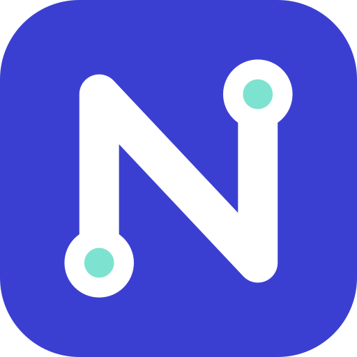
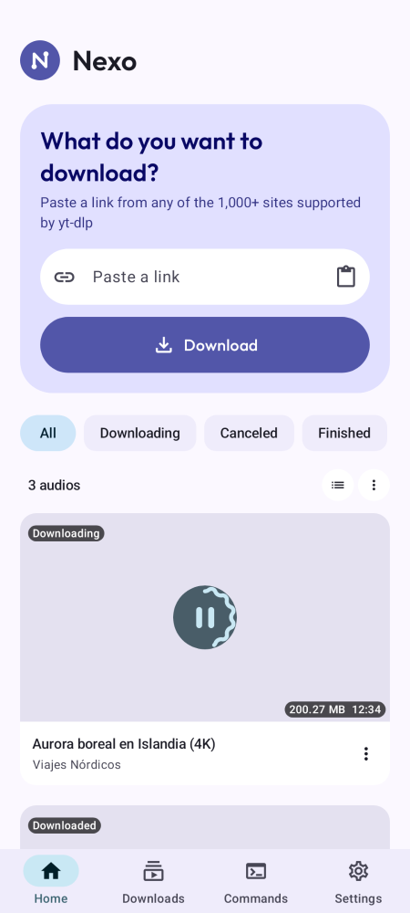
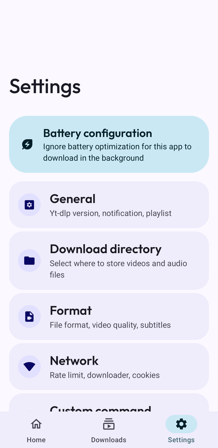
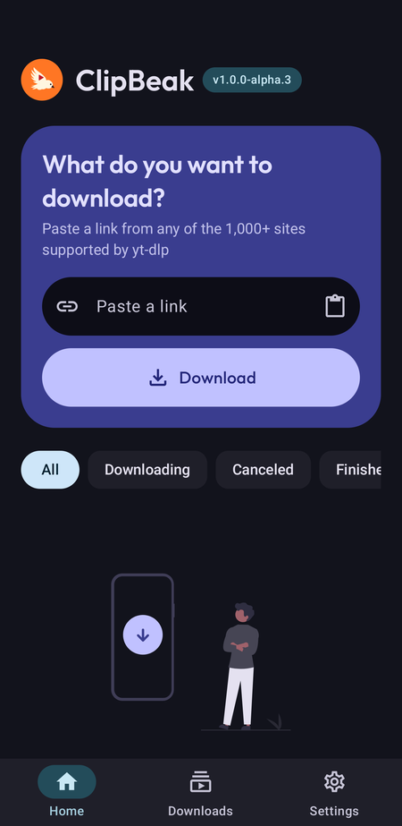
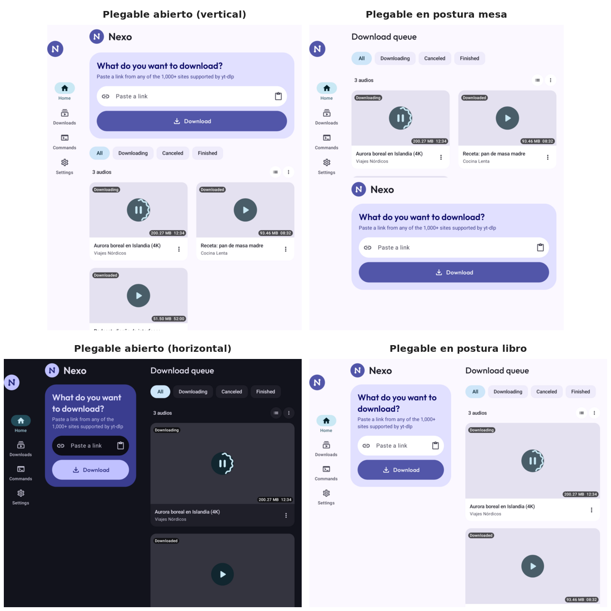

<div align="center">



# ClipBeak

[English](README.md) · **Español**

**Descargador de video y audio para Android, con interfaz Material 3 Expressive.**
Proyecto original de JunkFood02 y los colaboradores de [Seal](https://github.com/JunkFood02/Seal). Rediseño de esta versión por gabrieldave. Motor de descarga: [yt-dlp](https://github.com/yt-dlp/yt-dlp).

[](LICENSE)
[](https://github.com/gabrieldave/Nexo/actions/workflows/build.yml)

<p>Capturas de la versión 1.0.0-alpha.2, publicada como Nexo.</p>





</div>

## Índice

1. [Qué es ClipBeak](#qué-es-clipbeak)
2. [Instalar](#instalar)
3. [Compilar desde el código fuente](#compilar-desde-el-código-fuente)
4. [Firmar tus propias versiones](#firmar-tus-propias-versiones)
5. [Publicar una release con GitHub Actions](#publicar-una-release-con-github-actions)
6. [Contribuir](#contribuir)
7. [Si haces tu propio fork de ClipBeak](#si-haces-tu-propio-fork-de-clipbeak)
8. [Licencia y créditos](#licencia-y-créditos)

## Qué es ClipBeak

ClipBeak es un fork de **Seal**, la app de JunkFood02 que ofrece una interfaz gráfica para yt-dlp. Conserva todas las funciones de Seal y cambia la experiencia:

- **Inicio nuevo:** pegas un enlace y descargas desde la primera pantalla.
- **Material 3 Expressive:** movimiento con física de resorte, formas redondeadas, indicadores que cambian de forma y progreso ondulado.
- **Navegación adaptable:** barra inferior en teléfonos y riel lateral en tablets, plegables abiertos y teléfonos en horizontal.
- **Hecho para plegables:** dos paneles en pantallas anchas, nada queda partido por la bisagra y hay una distribución especial para la postura "mesa".
- **Identidad propia:** pájaro naranja con el símbolo de reproducción en el ala, tipografía Outfit y paleta índigo en la interfaz. Se instala junto a Seal sin conflicto (`io.github.gabrieldave.nexo`).



Funciones heredadas de Seal: descarga de video y audio de los [sitios compatibles con yt-dlp](https://github.com/yt-dlp/yt-dlp/blob/master/supportedsites.md), metadatos y miniaturas en el audio, listas de reproducción completas, aria2c como descargador externo, subtítulos y comandos personalizados de yt-dlp con plantillas.

La lista completa de cambios respecto a Seal está en [NOTICE.md](NOTICE.md).

## Instalar

ClipBeak requiere Android 7.0 o superior. Las versiones públicas 1.0.0-alpha.1 y 1.0.0-alpha.2 llevan el nombre **Nexo**.

**Para probar ClipBeak:** inicia sesión en GitHub, abre una [compilación correcta de la rama principal](https://github.com/gabrieldave/Nexo/actions/workflows/build.yml?query=branch%3Amain), baja a **Artifacts** y descarga `clipbeak-debug-apk`. Extrae el ZIP y abre el APK en tu Android de 64 bits ARM. Aparecerá como **ClipBeak Debug**. Tiene su propio identificador y se instala junto a la versión pública de Nexo. GitHub conserva cada archivo de prueba durante 14 días.

**Para instalar una versión pública:**

1. Entra a [Releases](https://github.com/gabrieldave/Nexo/releases).
2. Descarga el APK que corresponde a tu teléfono. Si no sabes cuál, usa **arm64-v8a**, que sirve para casi todos los teléfonos actuales. El APK **universal** funciona en todos, pero pesa más.
3. Ábrelo en el teléfono y permite "Instalar apps desconocidas" para tu navegador o gestor de archivos cuando Android lo pida.
4. Las actualizaciones llegan desde la propia app: Ajustes → Acerca de → Actualización automática.

## Compilar desde el código fuente

### Requisitos

- **JDK 21**, la versión configurada en el proyecto y en GitHub Actions.
- **Android SDK** con la plataforma 35. La forma más simple de tenerlo es instalar [Android Studio](https://developer.android.com/studio).
- Unos 10 GB libres para Gradle y el SDK.

### Pasos

```bash
# 1. Clonar
git clone https://github.com/gabrieldave/Nexo.git
cd Nexo

# 2. Indicar dónde está el SDK (Android Studio lo hace solo al abrir el proyecto)
# Si hace falta, crea local.properties con sdk.dir apuntando a tu SDK.

# 3. Compilar un APK de prueba
./gradlew assembleGenericDebug
```

El APK queda en `app/build/outputs/apk/generic/debug/`. Ese APK está firmado con una llave de depuración: sirve para probar, no para distribuir.

En Windows usa `gradlew.bat` en lugar de `./gradlew`.

### Variantes

| Variante | Comando | Para qué |
|---|---|---|
| `genericDebug` | `./gradlew assembleGenericDebug` | Probar en tu teléfono |
| `genericRelease` | `./gradlew assembleGenericRelease` | Versión optimizada (necesita llave para instalarse) |
| `fdroidRelease` | `./gradlew assembleFdroidRelease` | Compilación para F-Droid, sin actualizador integrado |

## Firmar tus propias versiones

Para actualizar una instalación existente, conserva su identidad de firma. Una rotación de llave requiere una transición compatible con las versiones de Android de tus usuarios. La llave la creas tú, gratis, en tu computadora. No hace falta Google Play Console.

### 1. Crear la llave (una sola vez)

Si ya tienes una llave (`.jks`) con sus contraseñas, puedes usarla y saltarte este paso.

```bash
keytool -genkeypair -v -keystore clipbeak-release.jks -alias clipbeak \
  -keyalg RSA -keysize 4096 -validity 10000
```

Al crear una llave nueva, escribe un nombre público como ClipBeak en los campos de nombre y organización del certificado. El alias interno de la llave es un dato distinto. Android distribuye ese certificado dentro de cada APK. Conserva la llave original de una app ya publicada para sus actualizaciones.

Guarda el archivo `.jks` y las contraseñas **fuera del repositorio**, con copia de respaldo. Si los pierdes, no podrás publicar actualizaciones de tu app.

### 2. Decirle a Gradle dónde está

Crea `keystore.properties` en la raíz del proyecto. Ya está en `.gitignore` y nunca se sube:

```properties
storeFile=/ruta/completa/a/clipbeak-release.jks
storePassword=tu_contraseña_del_almacén
keyAlias=clipbeak
keyPassword=tu_contraseña_de_la_llave
```

### 3. Compilar firmado

```bash
./gradlew assembleGenericRelease
```

## Publicar una release con GitHub Actions

El repositorio trae dos workflows:

- **Build** (`.github/workflows/build.yml`): compila un APK de prueba en cada push y pull request. **Funciona en forks** porque no usa secretos.
- **Release** (`.github/workflows/release.yml`): al subir una etiqueta `v*`, compila, firma y publica la release con los APKs. En un fork sin llave no falla: avisa y se detiene.

El flujo verifica la firma sin imprimir los campos del certificado. Detiene la publicación si reconoce el certificado de las dos primeras versiones alfa, que contiene datos personales. Una transición de firma requiere comprobar la continuidad de las actualizaciones en las versiones de Android compatibles.

Para activar las releases firmadas en tu repositorio:

1. Desde una carpeta privada fuera del repositorio, convierte la llave a texto:
   - Linux: `base64 -w0 clipbeak-release.jks > clipbeak-release.b64`
   - macOS: `base64 -i clipbeak-release.jks -o clipbeak-release.b64`
   - Windows (PowerShell): `[Convert]::ToBase64String([IO.File]::ReadAllBytes("clipbeak-release.jks")) > clipbeak-release.b64`
2. En GitHub, ve a **Settings → Secrets and variables → Actions → New repository secret** y crea:
   - `KEYSTORE_BASE64`: el contenido de `clipbeak-release.b64`
   - `KEYSTORE_PASSWORD`, `KEY_ALIAS` y `KEY_PASSWORD`
3. Borra `clipbeak-release.b64` de tu computadora.
4. Sube la versión en `buildSrc/src/main/kotlin/Version.kt`, haz commit y crea la etiqueta con el mismo número:

```bash
# Ejemplo para una versión futura con ese número en Version.kt
git tag v1.0.0-alpha.3
git push origin v1.0.0-alpha.3
```

La versión se define **solo** en `Version.kt`. El nombre, el `versionCode`, el nombre del APK y el actualizador salen de ahí.

## Contribuir

1. Haz un fork y crea una rama: `git checkout -b mejora/descripcion-corta`.
2. Antes de un cambio grande, abre un issue para comentarlo.
3. Da formato al código con `./gradlew ktfmtFormat`.
4. Comprueba que compila con `./gradlew assembleGenericDebug`.
5. Abre un pull request con capturas de antes y después si cambias la interfaz.

**Traducciones:** los textos están en `app/src/main/res/values-*/strings.xml`. Los textos nuevos de ClipBeak están al final de `values/strings.xml` (inglés) y `values-es/strings.xml` (español). Puedes traducirlos a otros idiomas con un pull request.

**Errores de descarga:** casi siempre vienen de yt-dlp o del sitio, no de la app. Revisa primero los [issues de yt-dlp](https://github.com/yt-dlp/yt-dlp/issues).

## Si haces tu propio fork de ClipBeak

Puedes hacerlo: es software libre. La GPLv3 te pide:

- Mantener la licencia GPLv3 y los avisos de copyright de Seal y de ClipBeak.
- Indicar qué cambiaste y cuándo (por ejemplo, en un NOTICE.md como el de este repo).
- Publicar el código fuente completo de cada APK que distribuyas.

Además te pedimos, para no confundir a los usuarios:

- Usar **otro nombre y otro icono**. El nombre "Seal" está prohibido en derivados por decisión de su autor.
- Cambiar el `applicationId` en `app/build.gradle.kts` y el repositorio del actualizador en `app/src/main/java/com/junkfood/seal/util/UpdateUtil.kt`.

## Licencia y créditos

ClipBeak es software libre bajo la **GNU General Public License v3.0** ([LICENSE](LICENSE)) y se distribuye **sin ninguna garantía**. Dentro de la app, abre Ajustes → Acerca de → Licencia y aviso legal para leer el texto completo sin conexión.

> [!IMPORTANT]
> ClipBeak no está afiliado a Seal ni a su autor, ni cuenta con su respaldo.

- **[Seal](https://github.com/JunkFood02/Seal)**, de JunkFood02 y sus colaboradores, la base de este proyecto. Si ClipBeak te resulta útil, considera [apoyar al desarrollador de Seal](https://github.com/sponsors/JunkFood02).
- [Fuentes de las versiones de FFmpeg y aria2 incluidas en Android](NOTICE.md#fuentes-de-ffmpeg-y-aria2).
- [yt-dlp](https://github.com/yt-dlp/yt-dlp), [youtubedl-android](https://github.com/yausername/youtubedl-android), [FFmpeg](https://ffmpeg.org), [aria2](https://github.com/aria2/aria2) y el resto de bibliotecas que aparecen en la pantalla de Créditos de la app.
- Fuente [Outfit](https://github.com/Outfitio/Outfit-Fonts), con licencia SIL Open Font License 1.1 (`app/src/main/assets/licenses/OFL-Outfit.txt`).
- Traducciones heredadas de la comunidad de Seal en [Hosted Weblate](https://hosted.weblate.org/projects/seal/).

## Uso responsable

ClipBeak es una herramienta. Respeta los derechos de autor y los términos de servicio de cada sitio. Descarga solo contenido que tengas derecho a guardar.
