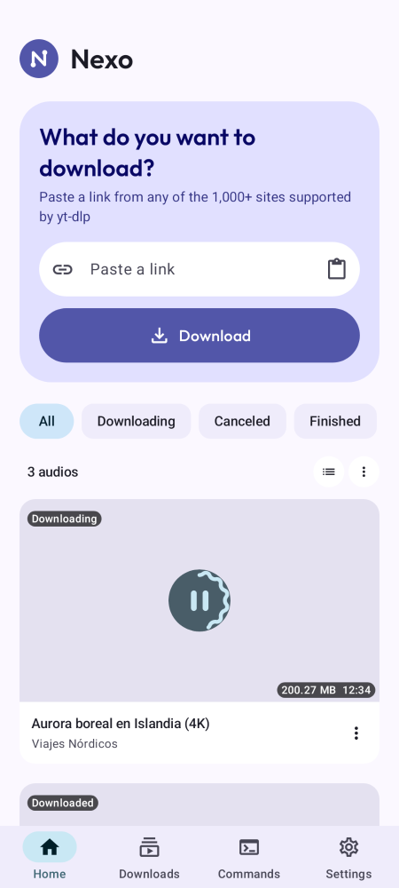

<div align="center">


# Nexo

**Descargador de video y audio para Android, con interfaz Material 3 Expressive.**
Basado en [Seal](https://github.com/JunkFood02/Seal) · Funciona con [yt-dlp](https://github.com/yt-dlp/yt-dlp)

[](LICENSE)
[](https://github.com/gabrieldave/Nexo/actions/workflows/build.yml)




</div>

## Índice

1. [Qué es Nexo](#qué-es-nexo)
2. [Instalar](#instalar)
3. [Compilar desde el código fuente](#compilar-desde-el-código-fuente)
4. [Firmar tus propias versiones](#firmar-tus-propias-versiones)
5. [Publicar una release con GitHub Actions](#publicar-una-release-con-github-actions)
6. [Contribuir](#contribuir)
7. [Si haces tu propio fork de Nexo](#si-haces-tu-propio-fork-de-nexo)
8. [Licencia y créditos](#licencia-y-créditos)

## Qué es Nexo

Nexo es un fork de **Seal**, la app de JunkFood02 que ofrece una interfaz gráfica para yt-dlp. Conserva todas las funciones de Seal y cambia la experiencia:

- **Inicio nuevo:** pegas un enlace y descargas desde la primera pantalla.
- **Material 3 Expressive:** movimiento con física de resorte, formas redondeadas, indicadores que cambian de forma y progreso ondulado.
- **Navegación adaptable:** barra inferior en teléfonos y riel lateral en tablets, plegables abiertos y teléfonos en horizontal.
- **Hecho para plegables:** dos paneles en pantallas anchas, nada queda partido por la bisagra y hay una distribución especial para la postura "mesa".
- **Identidad propia:** paleta índigo, tipografía Outfit e icono propio. Se instala junto a Seal sin conflicto (`io.github.gabrieldave.nexo`).


Funciones heredadas de Seal: descarga de video y audio de los [sitios compatibles con yt-dlp](https://github.com/yt-dlp/yt-dlp/blob/master/supportedsites.md), metadatos y miniaturas en el audio, listas de reproducción completas, aria2c como descargador externo, subtítulos y comandos personalizados de yt-dlp con plantillas.

La lista completa de cambios respecto a Seal está en [NOTICE.md](NOTICE.md).

## Instalar

1. Entra a [Releases](https://github.com/gabrieldave/Nexo/releases).
2. Descarga el APK que corresponde a tu teléfono. Si no sabes cuál, usa **arm64-v8a**, que sirve para casi todos los teléfonos actuales. El APK **universal** funciona en todos, pero pesa más.
3. Ábrelo en el teléfono y permite "Instalar apps desconocidas" para tu navegador o gestor de archivos cuando Android lo pida.
4. Las actualizaciones llegan desde la propia app: Ajustes → Acerca de → Actualización automática.

Nexo requiere Android 7.0 o superior.

## Compilar desde el código fuente

### Requisitos

- **JDK 17 o superior** (recomendado: JDK 21).
- **Android SDK** con la plataforma 35. La forma más simple de tenerlo es instalar [Android Studio](https://developer.android.com/studio).
- Unos 10 GB libres para Gradle y el SDK.

### Pasos

```bash
# 1. Clonar
git clone https://github.com/gabrieldave/Nexo.git
cd Nexo

# 2. Indicar dónde está el SDK (Android Studio lo hace solo al abrir el proyecto)
echo "sdk.dir=$HOME/Android/Sdk" > local.properties

# 3. Compilar un APK de prueba
./gradlew assembleGenericDebug
```

El APK queda en `app/build/outputs/apk/generic/debug/`. Ese APK está firmado con una llave de depuración: sirve para probar, no para distribuir.

En Windows usa `gradlew.bat` en lugar de `./gradlew`.

### Variantes

| Variante | Comando | Para qué |
|---|---|---|
| `genericDebug` | `./gradlew assembleGenericDebug` | Probar en tu teléfono |
| `genericRelease` | `./gradlew assembleGenericRelease` | Versión optimizada (necesita llave para instalarse) |
| `fdroidRelease` | `./gradlew assembleFdroidRelease` | Compilación para F-Droid, sin actualizador integrado |

## Firmar tus propias versiones

Android solo instala una actualización si viene firmada con **la misma llave** que la versión anterior. La llave la creas tú, gratis, en tu computadora. No hace falta Google Play Console.

### 1. Crear la llave (una sola vez)

Si ya tienes una llave (`.jks`) con sus contraseñas, puedes usarla y saltarte este paso.

```bash
keytool -genkeypair -v -keystore nexo-release.jks -alias nexo \
  -keyalg RSA -keysize 4096 -validity 10000
```

Guarda el archivo `.jks` y las contraseñas **fuera del repositorio**, con copia de respaldo. Si los pierdes, no podrás publicar actualizaciones de tu app.

### 2. Decirle a Gradle dónde está

Crea `keystore.properties` en la raíz del proyecto. Ya está en `.gitignore` y nunca se sube:

```properties
storeFile=/ruta/completa/a/nexo-release.jks
storePassword=tu_contraseña_del_almacén
keyAlias=nexo
keyPassword=tu_contraseña_de_la_llave
```

### 3. Compilar firmado

```bash
./gradlew assembleGenericRelease
```

## Publicar una release con GitHub Actions

El repositorio trae dos workflows:

- **Build** (`.github/workflows/build.yml`): compila un APK de prueba en cada push y pull request. **Funciona en forks** porque no usa secretos.
- **Release** (`.github/workflows/release.yml`): al subir una etiqueta `v*`, compila, firma y publica la release con los APKs. En un fork sin llave no falla: avisa y se detiene.

Para activar las releases firmadas en tu repositorio:

1. Convierte la llave a texto:
   - Linux: `base64 -w0 nexo-release.jks > nexo-release.b64`
   - macOS: `base64 -i nexo-release.jks -o nexo-release.b64`
   - Windows (PowerShell): `[Convert]::ToBase64String([IO.File]::ReadAllBytes("nexo-release.jks")) > nexo-release.b64`
2. En GitHub, ve a **Settings → Secrets and variables → Actions → New repository secret** y crea:
   - `KEYSTORE_BASE64`: el contenido de `nexo-release.b64`
   - `KEYSTORE_PASSWORD`, `KEY_ALIAS` y `KEY_PASSWORD`
3. Borra `nexo-release.b64` de tu computadora.
4. Sube la versión en `buildSrc/src/main/kotlin/Version.kt`, haz commit y crea la etiqueta con el mismo número:

```bash
git tag v1.0.0-alpha.1
git push origin v1.0.0-alpha.1
```

La versión se define **solo** en `Version.kt`. El nombre, el `versionCode`, el nombre del APK y el actualizador salen de ahí.

## Contribuir

1. Haz un fork y crea una rama: `git checkout -b mejora/descripcion-corta`.
2. Antes de un cambio grande, abre un issue para comentarlo.
3. Da formato al código con `./gradlew ktfmtFormat`.
4. Comprueba que compila con `./gradlew assembleGenericDebug`.
5. Abre un pull request con capturas de antes y después si cambias la interfaz.

**Traducciones:** los textos están en `app/src/main/res/values-*/strings.xml`. Los textos nuevos de Nexo están al final de `values/strings.xml` (inglés) y `values-es/strings.xml` (español). Puedes traducirlos a otros idiomas con un pull request.

**Errores de descarga:** casi siempre vienen de yt-dlp o del sitio, no de la app. Revisa primero los [issues de yt-dlp](https://github.com/yt-dlp/yt-dlp/issues).

## Si haces tu propio fork de Nexo

Puedes hacerlo: es software libre. La GPLv3 te pide:

- Mantener la licencia GPLv3 y los avisos de copyright de Seal y de Nexo.
- Indicar qué cambiaste y cuándo (por ejemplo, en un NOTICE.md como el de este repo).
- Publicar el código fuente completo de cada APK que distribuyas.

Además te pedimos, para no confundir a los usuarios:

- Usar **otro nombre y otro icono**. El nombre "Seal" está prohibido en derivados por decisión de su autor.
- Cambiar el `applicationId` en `app/build.gradle.kts` y el repositorio del actualizador en `app/src/main/java/com/junkfood/seal/util/UpdateUtil.kt`.

## Licencia y créditos

Nexo es software libre bajo la **GNU General Public License v3.0** ([LICENSE](LICENSE)) y se distribuye **sin ninguna garantía**.

> [!IMPORTANT]
> Nexo no está afiliado a Seal ni a su autor, ni cuenta con su respaldo.

- **[Seal](https://github.com/JunkFood02/Seal)**, de JunkFood02 y sus colaboradores, la base de este proyecto. Si Nexo te resulta útil, considera [apoyar al desarrollador de Seal](https://github.com/sponsors/JunkFood02).
- [yt-dlp](https://github.com/yt-dlp/yt-dlp), [youtubedl-android](https://github.com/yausername/youtubedl-android), [FFmpeg](https://ffmpeg.org), [aria2](https://github.com/aria2/aria2) y el resto de bibliotecas que aparecen en la pantalla de Créditos de la app.
- Fuente [Outfit](https://github.com/Outfitio/Outfit-Fonts), con licencia SIL Open Font License 1.1 (`app/src/main/assets/licenses/OFL-Outfit.txt`).
- Traducciones heredadas de la comunidad de Seal en [Hosted Weblate](https://hosted.weblate.org/projects/seal/).

## Uso responsable

Nexo es una herramienta. Respeta los derechos de autor y los términos de servicio de cada sitio. Descarga solo contenido que tengas derecho a guardar.

---

## English

**Nexo** is a fork of [Seal](https://github.com/JunkFood02/Seal) by JunkFood02, redesigned with Material 3 Expressive and adaptive layouts for phones, tablets and foldables. It is licensed under the GNU GPL v3.0 and is not affiliated with or endorsed by the Seal project. Build with `./gradlew assembleGenericDebug` (JDK 17+, Android SDK 35). See [NOTICE.md](NOTICE.md) for the list of modifications.
