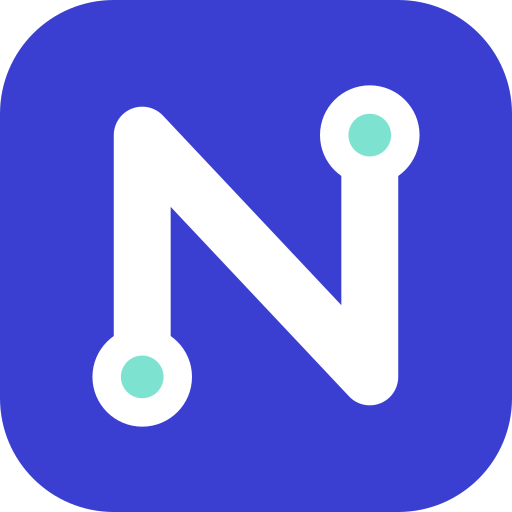
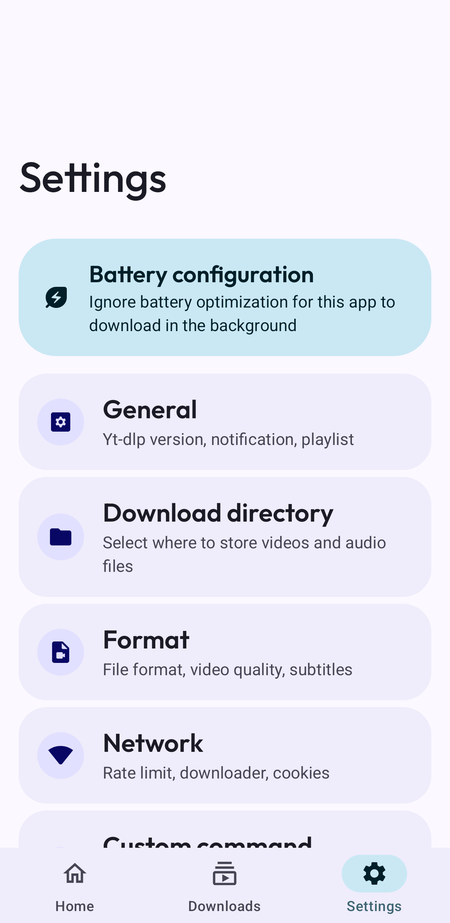
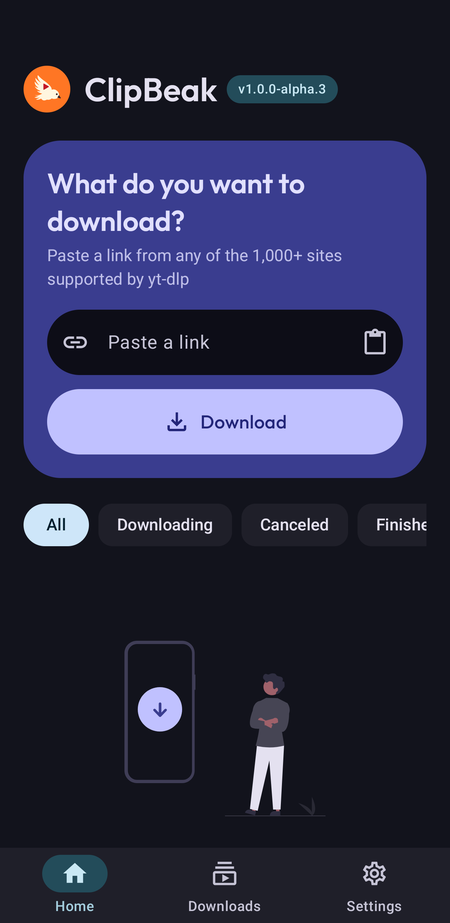
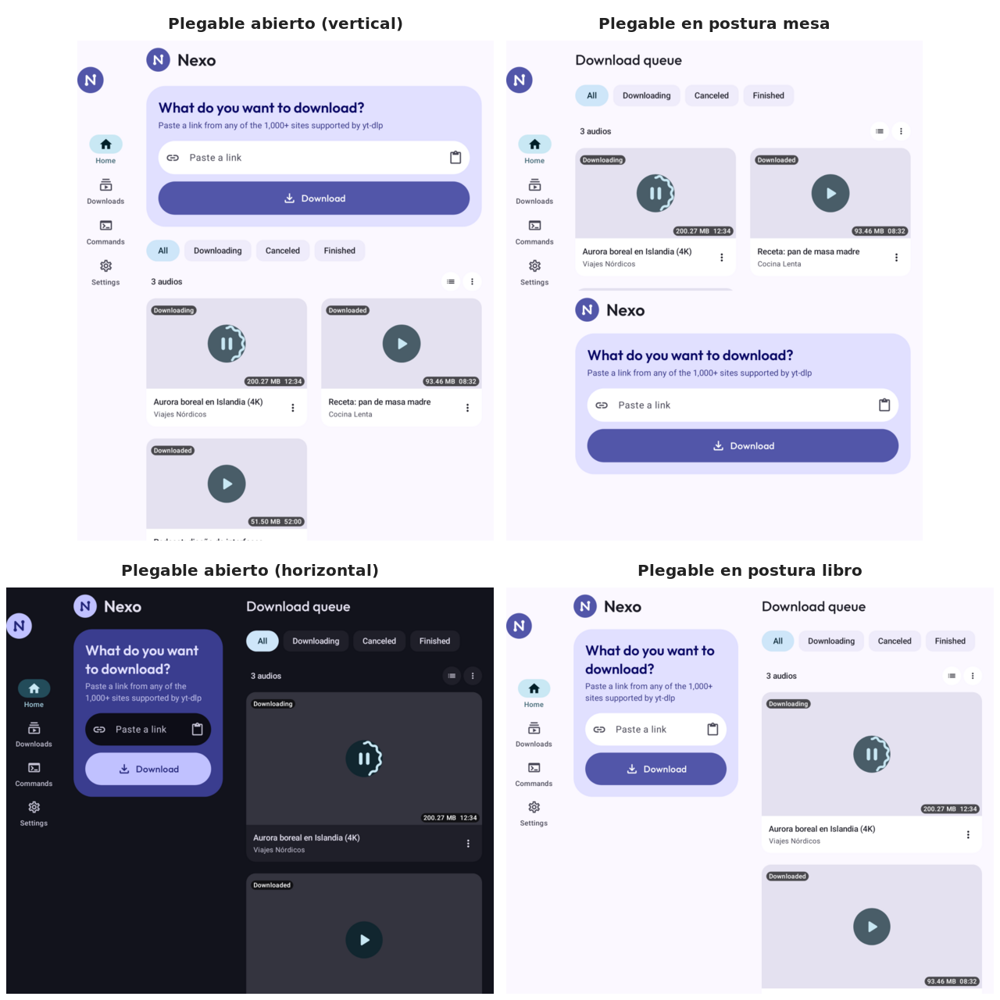

<div align="center">



# ClipBeak

**English** · [Español](README.es.md)

**Download video and audio on Android. Paste a link, choose a format and save it to your device.**

ClipBeak is an independent redesign of [Seal](https://github.com/JunkFood02/Seal), originally developed by JunkFood02 and the Seal contributors. gabrieldave maintains this fork and redesigned its interface. Downloads are powered by [yt-dlp](https://github.com/yt-dlp/yt-dlp).

[](LICENSE)
[](https://github.com/gabrieldave/Nexo/actions/workflows/build.yml)

<p>Screenshots from version 1.0.0-alpha.2, released under the name Nexo.</p>





</div>

## Contents

1. [Features](#features)
2. [Install](#install)
3. [Build from source](#build-from-source)
4. [Sign your own builds](#sign-your-own-builds)
5. [Publish with GitHub Actions](#publish-with-github-actions)
6. [Contribute](#contribute)
7. [Create a fork](#create-a-fork)
8. [License and credits](#license-and-credits)

## Features

- Paste a link on the home screen to configure a download.
- Download videos, extract audio, save playlists and embed subtitles from [sites supported by yt-dlp](https://github.com/yt-dlp/yt-dlp/blob/master/supportedsites.md). Seal also provides audio metadata and thumbnails, optional aria2c downloads and custom command templates.
- Navigate with a bottom bar on phones or a side rail on wider screens. Foldable layouts place content on either side of the hinge and adapt to tabletop mode.
- The redesigned interface uses Material 3 Expressive, Outfit type, an indigo palette and an orange bird icon. ClipBeak can be installed alongside Seal. Its release application ID is `io.github.gabrieldave.nexo`.



See [NOTICE.md](NOTICE.md) for the dated list of changes from Seal.

## Install

ClipBeak requires Android 7.0 or later. Public releases 1.0.0-alpha.1 and 1.0.0-alpha.2 carry the previous name, **Nexo**.

**To try ClipBeak:** sign in to GitHub, open a [successful build on the main branch](https://github.com/gabrieldave/Nexo/actions/workflows/build.yml?query=branch%3Amain) and download `clipbeak-debug-apk` under **Artifacts**. Unzip it and open the APK on an ARM64 Android device. It appears as **ClipBeak Debug** and installs alongside the Nexo release under a separate application ID. Each build artifact is kept for 14 days.

**To install a published release:**

1. Open [GitHub Releases](https://github.com/gabrieldave/Nexo/releases).
2. Choose the APK for your device. Most recent Android phones use **arm64-v8a**. The larger **universal** APK includes every supported architecture.
3. Open the APK. If Android prompts you, grant your browser or file manager permission to install apps from that source.
4. For in-app updates, see Settings → About → Auto-update.

## Build from source

Install **JDK 21** and **Android SDK Platform 35**. Allow about 10 GB for Gradle and the SDK. [Android Studio](https://developer.android.com/studio) can install the SDK and set its location for you.

```bash
git clone https://github.com/gabrieldave/Nexo.git
cd Nexo
./gradlew assembleGenericDebug
```

If Gradle cannot locate the SDK, create `local.properties` at the repository root and set `sdk.dir` to the full path of your SDK. On Windows, run `gradlew.bat` in place of `./gradlew`.

| Variant | Command | Output |
| --- | --- | --- |
| `genericDebug` | `./gradlew assembleGenericDebug` | Debug-signed APKs for testing in `app/build/outputs/apk/generic/debug/` |
| `genericRelease` | `./gradlew assembleGenericRelease` | Optimized release APKs. Configure signing before installing or distributing them. |
| `fdroidRelease` | `./gradlew assembleFdroidRelease` | F-Droid build with the in-app updater disabled |

## Sign your own builds

To update existing installations, preserve their signing identity. Rotating the signing key requires an update path compatible with the Android versions you support.

1. If you already maintain a release keystore, keep it and its backup. For a new app identity, create the keystore in a private directory outside the repository.

   ```bash
   keytool -genkeypair -v -keystore clipbeak-release.jks -alias clipbeak \
     -keyalg RSA -keysize 4096 -validity 10000
   ```

   The certificate is public in every signed APK. Enter a public project name in its name and organization fields. The internal key alias is a separate setting. Back up the keystore and passwords securely.

2. Create `keystore.properties` at the repository root. Git ignores this file.

   ```properties
   storeFile=/full/path/to/clipbeak-release.jks
   storePassword=your_keystore_password
   keyAlias=clipbeak
   keyPassword=your_key_password
   ```

3. Run `./gradlew assembleGenericRelease`.

## Publish with GitHub Actions

The [Build workflow](.github/workflows/build.yml) creates a debug APK on branch pushes and pull requests without release credentials. The [Release workflow](.github/workflows/release.yml) builds, signs and publishes APKs when you push a `v*` tag. In forks without a signing key, it displays a notice and skips publication.

The release workflow verifies the APK without printing certificate fields. It blocks the signing certificate from the first two alphas because that certificate contains personal information. Verify the update path on supported Android versions before changing signing identities.

To configure release signing in your repository:

1. From a private directory outside the repository, encode the keystore as Base64.

   | Platform | Command |
   | --- | --- |
   | Linux | `base64 -w0 clipbeak-release.jks > clipbeak-release.b64` |
   | macOS | `base64 -i clipbeak-release.jks -o clipbeak-release.b64` |
   | Windows PowerShell | `[Convert]::ToBase64String([IO.File]::ReadAllBytes("clipbeak-release.jks")) > clipbeak-release.b64` |

2. Under **Settings → Secrets and variables → Actions**, create the repository secrets `KEYSTORE_BASE64`, `KEYSTORE_PASSWORD`, `KEY_ALIAS` and `KEY_PASSWORD`. The first holds the contents of the Base64 file.
3. Delete the temporary Base64 file from your computer.
4. Update [Version.kt](buildSrc/src/main/kotlin/Version.kt), commit the change and push a new tag with the same version number. For example, for a future `1.0.0-alpha.3` release:

   ```bash
   git tag v1.0.0-alpha.3
   git push origin v1.0.0-alpha.3
   ```

## Contribute

Fork the repository, create a branch and open an issue before starting a large change. Format Kotlin with `./gradlew ktfmtFormat` and build with `./gradlew assembleGenericDebug`. Include before-and-after screenshots in pull requests that change the interface. See [CONTRIBUTING.md](CONTRIBUTING.md).

Translation files live under `app/src/main/res/values-*/strings.xml`. See the [English strings](app/src/main/res/values/strings.xml) and [Spanish strings](app/src/main/res/values-es/strings.xml) for text introduced by ClipBeak. For site-specific download failures, check the [yt-dlp issue tracker](https://github.com/yt-dlp/yt-dlp/issues).

## Create a fork

Keep the GPLv3 license and existing copyright notices, identify and date your modifications, and provide the corresponding source for the APKs you distribute.

Please choose a distinct name and icon, set your own application ID in [app/build.gradle.kts](app/build.gradle.kts), and point [the updater](app/src/main/java/com/junkfood/seal/util/UpdateUtil.kt) to your releases. The Seal project reserves the Seal name for its own downloader.

## License and credits

ClipBeak is free software under the [GNU General Public License v3.0](LICENSE), distributed without warranty. The full license is also available offline from Settings → About → License and legal notice. Third-party components retain their own notices.

- **[Seal](https://github.com/JunkFood02/Seal)** by JunkFood02 and contributors is the original Android app. ClipBeak is an independent fork without affiliation or endorsement. [Support Seal’s original developer](https://github.com/sponsors/JunkFood02).
- [yt-dlp](https://github.com/yt-dlp/yt-dlp), [youtubedl-android](https://github.com/yausername/youtubedl-android), [FFmpeg](https://ffmpeg.org) and [aria2](https://github.com/aria2/aria2) provide downloading and media processing. See the [native component source notes](NOTICE.md#fuentes-de-ffmpeg-y-aria2) and the app’s Credits screen.
- [Outfit](https://github.com/Outfitio/Outfit-Fonts) is bundled under the [SIL Open Font License 1.1](app/src/main/assets/licenses/OFL-Outfit.txt).
- Community translations originated on [Seal’s Weblate project](https://hosted.weblate.org/projects/seal/).

## Responsible use

Download content you have the right to save. Respect copyright and each site’s terms of service.
